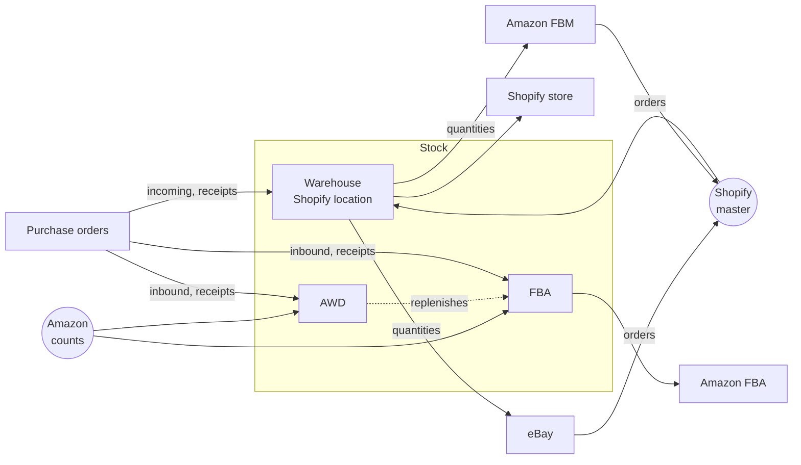

# Stock model (Phase 1)

Part of the [inventory sync spec](README.md). How the master count, locations and channels fit together, and what every
combination of connected accounts does. Phase 1 builds this model and shows it; Copacker writes nothing to any platform
until [Phase 2](quantity-sync.md).

## Today

What exists before this spec, so the changes are clear:

- **Buyers:** Copacker holds no stock count of its own. It copies Shopify's per-location `available`, `on_hand`,
  `incoming` and `committed`, plus FBA and AWD for the US (`src/server/stock.ts`), and adds units on open purchase
  orders.
- **eBay and FBM:** eBay has no stock source. FBM stock is never read.
- **Suppliers:** the only count Copacker owns is `supplier_products.onHand`. Open purchase orders reserve against it
  from the moment they're sent. Accepting a shipment's commercial invoice takes the packed units off it
  (`src/server/supplier-stock.ts`).
- **Location classes:** each Shopify location is `merchant`, `amazon_mirror`, `excluded` or `unresolved`
  (`inventory_location_mappings`). The class is taken from its fulfillment service, and the buyer can override it in
  Settings.
- **Accounts:** one account per platform per workspace, enforced by a unique index on `connections (orgId, provider)`.
  Only buyer workspaces sync stock and orders.
- **Writes:** nothing writes a quantity anywhere. Shopify unit cost is the only store write.

## The master

Each workspace has one master: `shopify` or `copacker`.

- **Default:**
  - A buyer with Shopify connected: `shopify`.
  - Everyone else, including every supplier: `copacker`.
  - A supplier that connects Shopify can choose `shopify`.
- **What it holds:** on hand for the workspace's managed locations. Everything else is either computed from it
  (available, channel quantities) or read from the platform that counts it (FBA, AWD).
- **Edits made outside the master are overwritten.** If eBay, Seller Central, or a Shopify location under a Copacker
  master shows a different number, Copacker sets it back and records the difference
  ([Quantity sync](quantity-sync.md#edits-made-outside-the-master)).
- **A Copacker master needs Copacker products.** Supplier workspaces have them (`supplier_product_groups`,
  `supplier_products`). Buyer workspaces don't yet: purchase order lines need Shopify variants (open question 2).
- **Where counts are edited:**
  - Shopify master: counts are edited in Shopify. Copacker's stock numbers are read-only, apart from the changes it
    makes itself (receipts, holds, marketplace sales).
  - Copacker master: counts are edited on Copacker's Inventory page, which the supplier uses already.

### Switching the master

A guided switch in Settings, with a preview:

- **Shopify to Copacker:**
  - Copacker creates a Copacker location for each counted Shopify location and copies its on hand.
  - The Shopify store then becomes a channel whose quantities Copacker sets.
- **Copacker to Shopify:**
  - Copacker writes its on hand into the chosen Shopify location once, using compare-and-set.
  - Shopify becomes the master, and the Copacker locations are archived.
- **Guards:**
  - Every Copacker-owned sync line pauses during the switch and has to be turned back on.
  - The switch is refused while a receipt or a sync write is still pending.

## Locations

| Location                                | Counted by | Count lives in | Copacker reads                                    | Copacker writes (Phase 2+)                                                                       | Receives purchase orders                      | Role                     |
| --------------------------------------- | ---------- | -------------- | ------------------------------------------------- | ------------------------------------------------------------------------------------------------ | --------------------------------------------- | ------------------------ |
| Shopify merchant location, Shopify master | Business   | Shopify        | Stock crawl and inventory webhooks                | Incoming (transfers), receipts, marketplace sales, B2B holds (reserved)                          | Yes: Shopify transfer, received in Copacker   | Managed                  |
| Shopify merchant location, Copacker master | Business   | Copacker       | Shopify orders, to record them as sales           | The available count, because the Shopify store is a channel                                      | Yes: received in Copacker                     | Managed, and a channel   |
| Copacker location                       | Business   | Copacker       | Nothing                                           | Nothing external                                                                                 | Yes: received in Copacker                     | Managed                  |
| Amazon FBA (US)                         | Amazon     | Amazon         | FBA inventory summaries and availability events   | Never                                                                                            | Yes: Amazon inbound, receipts read from Amazon | Reported                 |
| Amazon AWD (US)                         | Amazon     | Amazon         | AWD inventory                                     | Never                                                                                            | Yes: AWD inbound, receipts read from Amazon   | Reported, replenishment  |
| Amazon app location in Shopify          | Amazon app | Shopify        | Snapshot, shown for reference                     | Never (see [deferred incoming](purchase-orders.md#fba-and-awd-incoming-in-shopify))              | No                                            | Mirror                   |
| Shopify Collective location             | Shopify    | Shopify        | Snapshot                                          | Never                                                                                            | No                                            | Excluded                 |
| 3PL fulfillment-service location        | The 3PL    | The 3PL's app  | Snapshot                                          | Never                                                                                            | Receipts recorded in Copacker only            | Unresolved until chosen  |

Rules:

- **Roles replace today's classes:** `merchant` → managed, `amazon_mirror` → mirror, and `excluded` and `unresolved`
  stay. Detection is unchanged: the fulfillment service's callback host, never the location's name.
- **3PL locations are out of scope.** As today, the buyer counts one (managed, read-only) or excludes it. Copacker never
  writes to a location a fulfillment service manages. A purchase order to it is received by hand in Copacker, and the
  receipt doesn't change Shopify.
- **AWD is a replenishment pool, not a sales channel** (as in [sales demand](../../sales-demand.md)). It feeds FBA and
  sells nothing.
- **Copacker locations:** a Copacker-master workspace starts with one, named "Stock" (open question 1). A supplier's
  existing on hand moves into it.
- **Copacker's own stock data:** a location that isn't Copacker's keeps its data in the snapshot tables. Only Copacker
  locations have ledger rows ([Data model](data-model.md)).

## Channels

| Channel                                         | Sells from                                         | Its quantity comes from                                                                          | Who can set it                               | How its orders reach the master                                                                                          |
| ----------------------------------------------- | -------------------------------------------------- | ------------------------------------------------------------------------------------------------ | -------------------------------------------- | ------------------------------------------------------------------------------------------------------------------------ |
| Shopify store (Online Store, POS, other Shopify channels) | Shopify locations                                  | Shopify master: Shopify itself. Copacker master: the Copacker location mapped to each Shopify location | Shopify (native), or Copacker                | Shopify master: natively. Copacker master: Copacker reads Shopify orders as sales                                        |
| Amazon FBA offers                               | FBA                                                | Amazon                                                                                           | Nobody                                       | Amazon ships them; no managed stock changes. Copied into Shopify for reporting in Phase 3, never touching Shopify stock   |
| Amazon FBM offers                               | Chosen managed locations                           | Computed by Copacker                                                                             | Copacker, another app, or nobody             | Copacker (a sale movement in Phase 2, a Shopify order in Phase 3), or another app's Shopify orders                       |
| eBay listings                                   | Chosen managed locations                           | Computed by Copacker                                                                             | Copacker, another app, or nobody             | Same as FBM                                                                                                              |
| B2B purchase orders (supplier workspaces)       | The supplier's managed locations                   | Available units, checked when the order is sent and accepted                                     | Copacker                                     | Held when the supplier accepts; taken when the shipment's invoice is accepted                                            |
| Later marketplaces (Walmart, TikTok Shop, Etsy, Faire) | Chosen managed locations                           | Computed by Copacker                                                                             | Copacker, another app, or nobody             | Same as eBay, through the channel adapter                                                                                |

Notes:

- **One Amazon SKU can be both FBA and FBM.** Amazon keeps a separate availability entry per fulfillment channel, and the
  listing keeps selling FBM from the business's own stock while FBA is empty. Copacker only ever writes the merchant
  entry (`DEFAULT`), never Amazon's (`AMAZON_NA`).
- **FBM is US only for now.** Stock and listing reads are US-only today. Orders already come from US, CA, MX and BR.
- **The same SKU on several eBay listings:** each listing shows the full computed quantity. A sale on one lowers the
  master, and the next push lowers the others.

## Quantities

For a managed location and an item:

| Quantity   | Meaning                                                                    | Shopify master                                              | Copacker master                                    |
| ---------- | -------------------------------------------------------------------------- | ----------------------------------------------------------- | -------------------------------------------------- |
| On hand    | Physical units at the location                                             | Shopify `on_hand`                                           | `stock_levels.onHand`                              |
| Committed  | Units in channel orders that haven't shipped                               | Shopify `committed` (its own orders, and Phase 3 orders)    | Open marketplace order lines Copacker has recorded |
| Held       | Units promised to accepted B2B purchase orders                             | Shopify `reserved`, moved from available by Copacker        | `stock_levels.held`                                |
| Incoming   | Units on open purchase orders to this location; never sellable             | Shopify `incoming`, from Copacker's transfers               | Computed from open purchase orders                 |
| Available  | On hand, less committed and held, and anything else set aside              | Shopify `available` (also less damaged, safety stock, quality control) | On hand − committed − held                          |

**Channel quantity** is the channel's rule applied to the sum of available units across the locations it sells from
([computing it](quantity-sync.md#computing-a-listings-quantity)).

**Reported locations keep their platform's own states:** FBA fulfillable, reserved and inbound; AWD available
distributable, reserved distributable and inbound.

**Never subtract twice:**

- Shopify's `available` already excludes committed and reserved units.
- FBA fulfillable already excludes customer orders.
- Open purchase orders are incoming, a separate state that is counted once (see
  [sales demand](../../sales-demand.md#availability-and-committed-orders)).

## Items and listing links

- **Items:**
  - A buyer's items are Shopify variants (Shopify master) or Copacker products (Copacker master).
  - A supplier's items are `supplier_products` rows.
  - A supplier with a Shopify master links its products to Shopify variants by SKU.
- **Listings:** every marketplace listing Copacker reads links to one item.
  - The link records **units per listing**: 1 for a single unit, the pack size for a multipack sold under its own SKU,
    or a bundle's components.
- **Automatic links:**
  - A listing links automatically when its SKU exactly matches one item's SKU. This is today's rule for Amazon and eBay
    sales.
  - Anything else is **Needs linking** on the Stock flow page: no match, several matches, or no SKU.
  - Titles are never matched.
- **Unlinked or ignored listings** are never synced.
- **Reading listings:**
  - eBay: through the Trading API (`GetSellerList`) for listings made in Seller Hub, and through the Inventory API for
    listings made there.
  - Amazon FBM: from the `GET_MERCHANT_LISTINGS_ALL_DATA` report and `getListingsItem`.
  - Both are read-only in Phase 1.
- **Unic:**
  - Its supplier SKUs are store codes, with -A, -B and so on added where one code was used for several products.
  - eBay listings that use the bare code need a manual link.
  - The Arrow blade has no SKU at all, so it is always linked by hand.

## Permutations

Every combination of connected accounts, with the defaults Copacker proposes. "Owner" is who owns a sync line: Copacker,
another app, the platform, or off.

### Buyer workspaces

| #   | Connected                          | Master                        | Stock                                                   | Channels and default owners                                                                                                                        | Purchase orders to your own location                                  | Purchase orders to Amazon                                 | Notes                                                                           |
| --- | ---------------------------------- | ----------------------------- | ------------------------------------------------------- | -------------------------------------------------------------------------------------------------------------------------------------------------- | --------------------------------------------------------------------- | --------------------------------------------------------- | ------------------------------------------------------------------------------- |
| B1  | Nothing                            | Copacker                      | Copacker location                                       | None                                                                                                                                               | Received in Copacker, adds to on hand                                 | Not possible without Amazon                               | Needs a buyer catalog (open question 2)                                         |
| B2  | Shopify                            | Shopify                       | Shopify locations                                       | Shopify store: platform                                                                                                                            | Shopify transfer shows Incoming; receiving moves it to Available       | Not possible without Amazon                               | Today's setup, plus receiving and Incoming                                      |
| B3  | Shopify, Copacker as master        | Copacker                      | One Copacker location per counted Shopify location     | Shopify store: quantities Copacker; Shopify orders read as sales                                                                                   | Received in Copacker, then pushed to Shopify                          | Not possible without Amazon                               | Edits in Shopify are overwritten; warned when chosen                            |
| B4  | Amazon                             | Copacker                      | Copacker location, FBA, AWD                             | FBA: platform. FBM: quantities off, sales Copacker                                                                                                 | Received in Copacker                                                  | Amazon inbound (as today); receipts read from Amazon      | Needs a buyer catalog                                                           |
| B5  | eBay                               | Copacker                      | Copacker location                                       | eBay: quantities off, sales Copacker                                                                                                               | Received in Copacker                                                  | Not possible without Amazon                               | Needs a buyer catalog                                                           |
| B6  | Shopify and Amazon                 | Shopify                       | Shopify locations, FBA, AWD; Amazon app location is a mirror | Shopify store: platform. FBA: platform. FBM: quantities and orders "another app" if Marketplace Connect is detected, otherwise off                    | Shopify transfer and receiving                                         | Amazon inbound; receipts read from Amazon                 | FBM sells from the chosen Shopify locations                                     |
| B7  | Shopify and eBay                   | Shopify                       | Shopify locations                                       | Shopify store: platform. eBay: quantities and orders "another app" if detected, otherwise off                                                        | Shopify transfer and receiving                                         | Not possible without Amazon                               |                                                                                 |
| B8  | Shopify, Amazon and eBay           | Shopify                       | Shopify locations, FBA, AWD                             | As B6 and B7                                                                                                                                       | Shopify transfer and receiving                                         | Amazon inbound; receipts read from Amazon                 | Fencing Club (below)                                                            |
| B9  | Amazon and eBay                    | Copacker                      | Copacker location, FBA, AWD                             | FBA: platform. FBM and eBay: quantities off, sales Copacker                                                                                       | Received in Copacker                                                  | Amazon inbound; receipts read from Amazon                 | Needs a buyer catalog                                                           |
| B10 | Any of the above and a 3PL in Shopify | As the row without the 3PL | Plus the 3PL location, unresolved until chosen          | Unchanged; a 3PL location can feed a channel only if the buyer counts it                                                                           | To the 3PL location: receipts recorded in Copacker only               | Unchanged                                                 | Out of scope beyond today's counting                                            |

"Detected" means Copacker has seen Shopify orders whose source or tag shows another app copying that marketplace's orders
into Shopify. Fencing Club's eBay orders arrive tagged `eBay` from Marketplace Connect. The owner is only a proposal: a
person confirms it on the Stock flow page.

### Supplier workspaces

Suppliers sell B2B through purchase orders. They may also sell retail. Supplier workspaces can't connect any platform
today; Phase 1 lifts that for eBay first.

| #   | Connected                          | Master                             | Stock                                   | Channels and default owners                                                                                         | Notes                                                                                   |
| --- | ---------------------------------- | ---------------------------------- | --------------------------------------- | ------------------------------------------------------------------------------------------------------------------- | --------------------------------------------------------------------------------------- |
| S1  | Nothing                            | Copacker                           | Copacker location                       | B2B                                                                                                                 | Today, plus the accept step and holds                                                   |
| S2  | eBay                               | Copacker                           | Copacker location                       | B2B. eBay: quantities off until turned on, sales Copacker                                                          | Unic (below)                                                                            |
| S3  | Shopify                            | Shopify, or Copacker by choice     | Shopify locations, or a Copacker location | B2B holds use Shopify's reserved quantity; taking uses an adjustment                                                | Supplier products link to Shopify variants by SKU                                       |
| S4  | Shopify and marketplaces           | As S3                              | As S3                                   | As B6 to B8, plus B2B                                                                                               |                                                                                         |
| S5  | Amazon                             | Copacker                           | Copacker location, FBA, AWD             | B2B from the Copacker location only. FBA and AWD stock is never available for B2B                                   | Amazon inbound for a supplier's own replenishment is out of scope                       |

### Validation

The Stock flow page refuses or warns about setups that lose or double-count stock:

1. **Quantities without sales (refused).** A channel whose quantities line Copacker owns needs its sales to reach the
   master. That means its sales line is on, or, with a Shopify master, its orders line is owned by Copacker or by another
   app that copies the orders into Shopify. Otherwise the channel's sales never lower the count, and the next push puts
   them back.
2. **Two owners (refused).** A line can't have Copacker and another app as owners at the same time.
3. **Unlinked destination (refused when sending).** With a Shopify master, a purchase order to your own location needs
   its delivery address linked to a Shopify merchant location. That's what Incoming and receipts are written to.
4. **Uncounted source (refused).** Mirror, excluded and unresolved locations can't feed a channel.
5. **Reported stock on marketplaces (refused).** Reported locations don't feed marketplace channels: FBA sells through
   Amazon's own offers only, and MCF is out of scope.
6. **Shopify as a channel (warning).** With a Copacker master and Shopify connected, count edits made in Shopify are
   overwritten.
7. **Unhandled listings (warning).** Needs linking listings on a channel whose quantities Copacker owns aren't synced.

## Examples

### Fencing Club (B8)

- **Today:**
  - Shopify is the store, with one merchant location.
  - Amazon sells FBA with FBM backup, and AWD replenishes FBA.
  - Marketplace Connect copies eBay and Amazon FBM orders into Shopify and sets their quantities.
  - Copacker only reads.
- **Phase 1:** the master is Shopify. The Amazon app location is a mirror. FBM and eBay quantities and orders are owned
  by "another app: Marketplace Connect". The map shows this with no change to any platform.
- **Phase 2:**
  - Purchase orders to the warehouse show as Incoming in Shopify and are received in Copacker.
  - Purchase orders to Amazon record Amazon's received counts.
  - eBay and FBM stay with Marketplace Connect unless a line is switched to Copacker. Switching quantities alone is
    allowed only if Marketplace Connect keeps copying the orders; verify that it can sync orders without quantities.
- **Phase 3:** each line moves from Marketplace Connect to Copacker in turn, following the
  [switch-over](marketplace-orders.md#switching-from-marketplace-connect).

### Unic Fencing (S2)

- **Setup:** the master is Copacker, with one location, "Stock".
- **Seeding and linking:**
  - Its on hand is seeded once from eBay's listing quantities (open question 5).
  - eBay listings link to supplier SKUs, some of them by hand.
- **Quantity sync:** the eBay quantities line is turned on after a preview.
- **When Fencing Club sends a purchase order:** nothing changes until Unic accepts it.
- **When Unic accepts:**
  - The accepted units are held.
  - eBay shows fewer.
- **When Unic's commercial invoice is accepted:**
  - The units come off on hand.
  - The hold is released, so the net change to available is zero.
- **An eBay sale:**
  - Commits the units.
  - When eBay reports the order shipped, they come off on hand.
- **A cancelled eBay order:** returns its committed units.
- **A count edit made in eBay:** set back to Copacker's number, with the difference logged.
