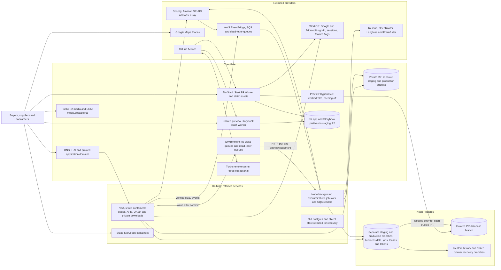
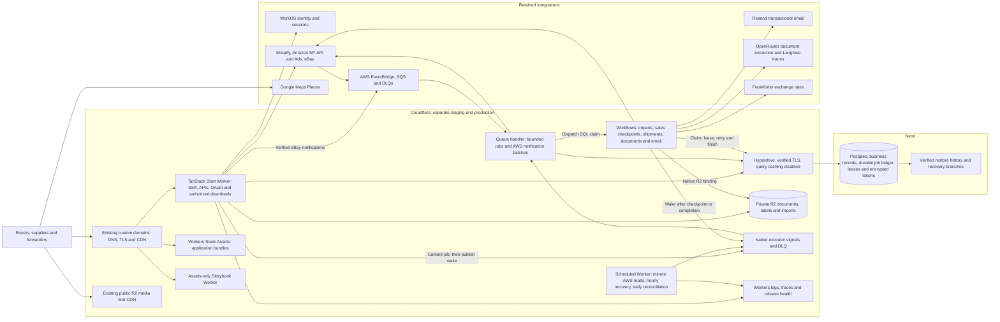

# Previous and current platform architecture

Part of the [migration specification](README.md). The first diagram captures the live state immediately before the
final web cutover on October 16, 2026. The second shows the deployed Cloudflare architecture.
It incorporates the separately completed Neon
and private R2 transfers; the original Railway-only database plan is superseded. The deployment checks and final
[acceptance record](acceptance.md) identify the deployed commits and verification evidence.

## State before the web cutover

Staging and production have separate databases, private buckets, queues and secrets. Their public application and
Storybook domains still route to Railway. TanStack Start is merged and the Cloudflare PR preview is deployed; the
existing Railway web deployments still run the previous Next.js artifacts.

Live evidence includes Railway service configuration, Cloudflare DNS and Hyperdrive readback, database migration
inventories and the verified storage manifests. Old Railway databases are recovery material, not an alternative
writable source of truth. The retained web and executor already use Neon and R2; no second database or file transfer
is required for the web runtime switch. WorkOS's shared staging identity environment remains intentional.

## Final state: Cloudflare web, jobs, files and CDN

Keep the same public application, Storybook and integration callback URLs. Each release builds web and Storybook from
one tested commit, applies any pending migrations through one direct Neon connection, and deploys Workflows and the scheduler from that commit. Application responses and private downloads remain authenticated and uncached.

The SQL job ledger owns work and retries; queues carry delivery signals. Bounded jobs execute directly in the queue
handler; long jobs use Workflows. Both share three SQL slots and the same domain handlers. Sales progress checkpoints
create separate attempts, while active jobs heartbeat. The hourly signal recovers missed publication and abandoned
leases; daily reconciliation retains its job identity. Scheduled SQS reads do not query Neon when empty.
See [background-job contracts](../../background-jobs.md) for cutover and live acceptance requirements.

Private R2 has no public document origin. Downloads recheck workspace membership, document revision and release state.
The web and Workflow steps use native R2 bindings. Public
media keeps its existing CDN origin. Returning to an old object store after new writes requires a verified reverse
delta; changing an endpoint alone is insufficient.

Hyperdrive has separate configurations for staging, production and each PR, with query caching disabled and certificate
and hostname verification enabled. Migrations use a verified direct Neon endpoint with an advisory lock. Local administrative tools use an explicitly selected database connection. Request language is resolved before action transactions so a nested profile
lookup cannot exhaust the small connection pool. See [database operations](../../neon.md).

## Delivery, previews and recovery

The GitHub plan does not support required reviewers for this private repository. Manual dispatch with an explicit
commit and saved-plan checks supplies the current approval mechanism. See [infrastructure operations](../../infrastructure.md)
and [release procedure](../../cloudflare.md). Terraform state backups are not database or document backups.

PR previews copy staging into an isolated Neon branch, use a private R2 prefix and receive no merchant integration
secrets. They have no background executor. Their static Storybook files are served through an assets-only Worker per PR. Preview expiration and closed-PR cleanup are independent of production retention.

Production acceptance includes existing sessions, role boundaries, authorized and unauthorized file access, immutable
file checksums, current provider callbacks, queue delivery, and matching web/Storybook commit metadata. Observe at least
one daily reconciliation cycle before retiring recovery services. Restore history and frozen recovery branches have
explicit expiry; record their actual retention in the release evidence.

## Background execution boundary

Cloudflare Queues executes bounded jobs and dispatches longer jobs to Workflows. Sales imports checkpoint each
14-day period and each follow-up operation. SQL retains job status, leases, retries and domain idempotency; native R2
serves documents in both web requests and Workflow steps. The scheduler reads AWS notification queues in bounded
batches. AWS EventBridge/SQS remains the external transport, with the existing reader credentials and permissions.

No D1, KV, Durable Object or separately hosted Node processor is required. Local development still runs a Node worker
against local Postgres. Deployed verification and Railway retirement are recorded in [acceptance](acceptance.md).

Sources: [runtime entry](../../../src/server.ts), [database context](../../../src/db/index.ts),
[private storage](../../../src/server/storage.ts), [document authorization](../../../src/server/http/api/documents/$id.ts),
[executor](../../../src/server/worker.ts), [job delivery](../../../src/server/job-delivery.ts),
[release workflow](../../../../../.github/workflows/release.yml), [preview lifecycle](../../neon.md#pr-previews),
[domain inventory](../../domains.md), and [cutover and recovery](cutover.md).
