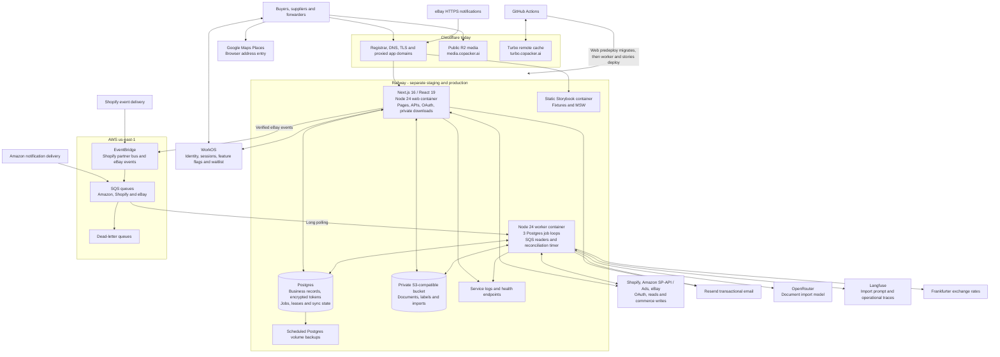
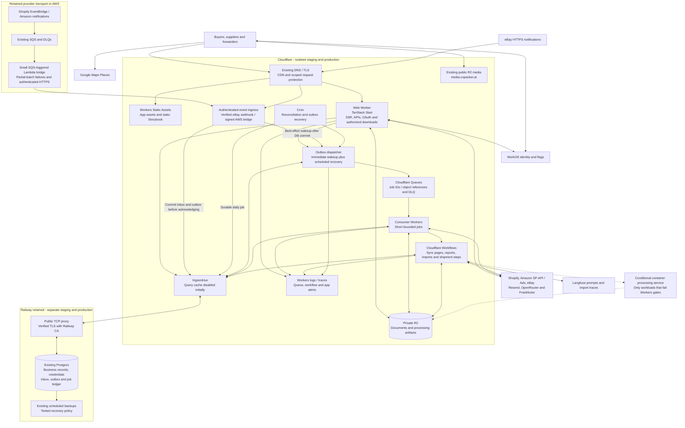
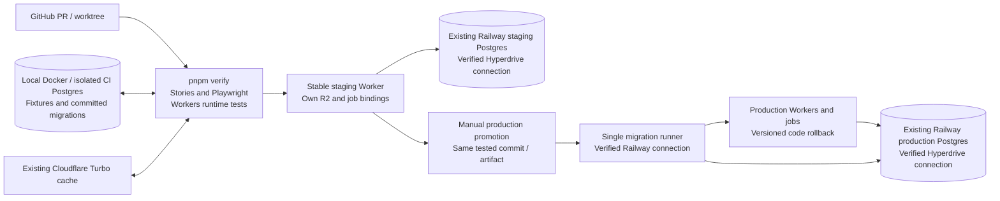

# Current and proposed platform architecture

Part of the [migration specification](README.md). This is a repository-derived inventory as of October 15, 2026, including
the current working tree. It is not a live audit of provider accounts. Resource sizes, traffic, configured CDN cache
rules, account entitlements and deployed revision drift remain to be measured. In particular, Storybook is present in
the deployment script and domain inventory but absent from the older operations resource-ID table.

## Current runtime

The Railway group is repeated independently for staging and production. Public media and the Turbo cache are shared
Cloudflare services. External provider configuration differs by environment; do not infer staging notification
subscriptions from production's topology.

Important current behavior:

- The web service and worker share each environment's Postgres and private bucket. The web service authorizes private
  downloads and rechecks document revision, access and release status before returning bytes with `private, no-store`.
- Jobs are already durable Postgres records. Claims use row locking, ten-minute leases and thirty-second heartbeats;
  job attempts fence stale workers. Some provider polling reschedules work through `PollAgain`.
- A ten-minute scheduler ensures one daily reconciliation job at 07:00 UTC. The worker also renews provider
  subscriptions. Web maintenance mode does **not** stop this worker.
- Shopify delivers through EventBridge, Amazon to SQS, and eBay through a verified web endpoint into EventBridge.
  Production and staging have separate queues; staging Shopify event delivery and eBay subscriptions are incomplete
  or disabled per the current notification inventory.
- WorkOS's staging environment currently serves both deployed environments. Database memberships and document access
  remain Copacker's responsibility. A hosting move must not silently change identity behavior.
- `@repo/aisle` is an in-process commerce/document library used by web and jobs; `@repo/copacker-emails` supplies email
  templates. Neither is an independently hosted service. Google/Microsoft sign-in is brokered through WorkOS.

Evidence: [operations](../../operations.md), [domains](../../domains.md), [notification topology](../../notifications.md),
[deployment](../../../../../.github/scripts/deploy.sh), [worker](../../../src/server/worker.ts),
[queue](../../../src/server/queue.ts), [database](../../../src/db/index.ts), [storage](../../../src/server/storage.ts),
[document download](../../../src/app/api/documents/[id]/route.ts), [import](../../../src/server/import-job.ts),
[tracing](../../../src/server/import-trace.ts) and [address entry](../../../src/components/address-fields.tsx).

## Proposed runtime

This effort moves compute and object storage while retaining the existing Railway Postgres databases and scheduled
backups. A database migration and Neon branching are deferred to a separate effort. TanStack Start is selected; its
implementation must pass framework, database-connectivity and document-runtime gates. Each environment has separate data, secrets, queues and
bindings. The optional processing service remains available if Workers cannot support existing file workloads.

Runtime decisions:

1. **Keep one source of truth.** Railway Postgres owns business state and job/audit records throughout this effort.
   Hyperdrive uses a separately verified external connection; retained Node services can keep Railway's private path.
   Queue messages carry identifiers.
   Domain changes and outbox inserts commit together. The dispatcher marks publication only after queue acceptance;
   retries can duplicate delivery, so consumers deduplicate by stable job/event identity and check revisions.
2. **Match execution to work.** Short emails and event handling can use consumers. Multi-page syncs and Amazon
   create/poll/download operations use durable steps and sleeps, with existing provider idempotency and reconciliation.
   Preserve job-key semantics, delayed runs, manual retries, cancellation and per-provider concurrency limits.
3. **Keep necessary AWS transport.** The current Amazon subscription path uses AWS destinations. Retain that boundary
   and initially preserve Shopify EventBridge. A small Lambda bridge returns success only after Cloudflare ingress
   durably records the event; failed items retry in SQS. eBay can enter Cloudflare directly. A bounded scheduled Worker
   that polls SQS is an alternative if a minute of ingestion latency is acceptable; choose one bridge, not both.
   [AWS documents SQS-triggered Lambda behavior](https://docs.aws.amazon.com/lambda/latest/dg/with-sqs.html).
4. **Separate public and private files.** Keep public media behind its existing custom domain/CDN. Move private
   documents to a separate R2 bucket; no public bucket URL. Preserve authenticated downloads and withdrawal checks.
   Initially bypass shared caching for authenticated pages/APIs and documents. Cache fingerprinted static assets and
   explicitly public responses. [R2 custom-domain caching](https://developers.cloudflare.com/cache/interaction-cloudflare-products/r2/).
5. **Make operational state explicit.** Move per-process throttling and long-lived feature-flag polling out of assumptions
   about a permanent server. Use edge rate limits for request abuse and database-backed coordination where correctness
   requires it. A Durable Object is optional if measured per-merchant coordination needs justify it; neither KV nor D1
   is required by the proposed architecture.
6. **Observe the whole path.** Correlate ingress ID, job ID, workspace, deployment and workflow. Alert on event age,
   outbox lag, DLQs, stuck work, repeated token failures, DB contention, memory/CPU errors and import failures. Continue
   Langfuse's allowlisted metadata approach; never log credentials or document contents.

## Delivery and environment topology

Today local development uses Portless and Docker Postgres, CI uses isolated Postgres and browser tests, staging deploys
automatically after CI, and production uses a promotion workflow. Preserve those controls. Database branching is deferred.
Optional writable cloud previews need their own isolated nonproduction Postgres database, storage, secrets and job
bindings; they must not write to production or compete over the staging dataset. They are not a prerequisite for this
migration. A later database-provider migration will define and provision its own branching workflow.
Keep the existing public domains and callback paths wherever possible. Update [domains](../../domains.md) when
configuration actually changes; this specification does not declare any future endpoint provisioned. See
[framework boundaries](framework.md) and [backend execution contracts](backend.md) for the implementation requirements.
