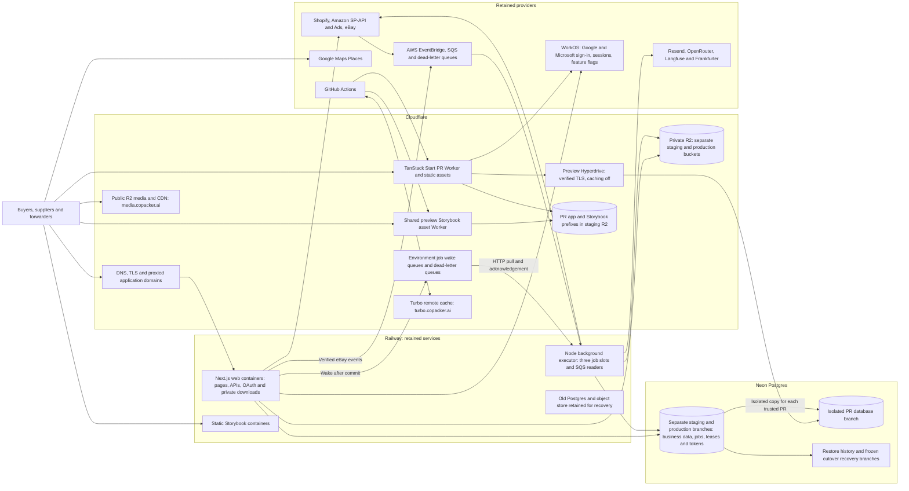
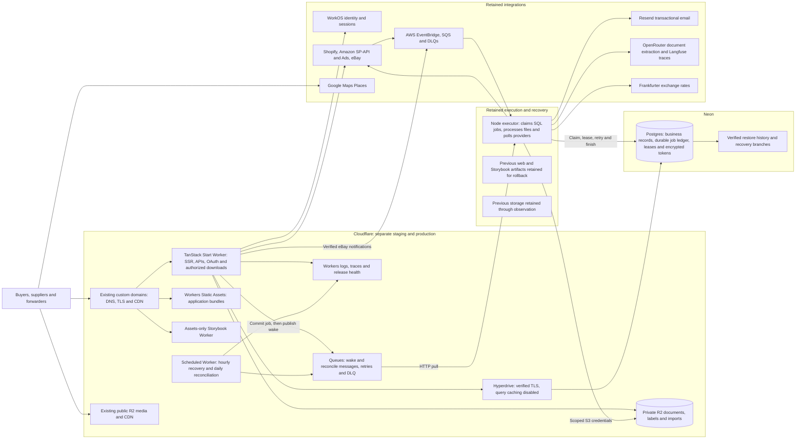
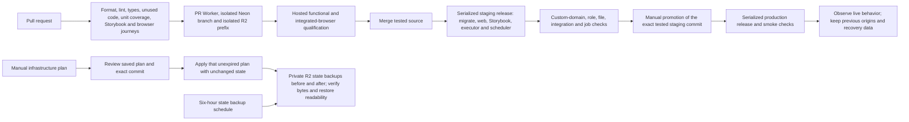

# Current and proposed platform architecture

Part of the [migration specification](README.md). The first diagram captures the live state immediately before the
final web cutover on October 16, 2026. The second is the release target. It incorporates the separately completed Neon
and private R2 transfers; the original Railway-only database plan is superseded. The deployment checks and final
acceptance record determine whether a target has been activated.

## State before the web cutover

Staging and production have separate databases, private buckets, queues and secrets. Their public application and
Storybook domains still route to Railway. TanStack Start is merged and the Cloudflare PR preview is deployed; the
existing Railway web deployments still run the previous Next.js artifacts.

Live evidence includes Railway service configuration, Cloudflare DNS and Hyperdrive readback, database migration
inventories and the verified storage manifests. Old Railway databases are recovery material, not an alternative
writable source of truth. The retained web and executor already use Neon and R2; no second database or file transfer
is required for the web runtime switch. WorkOS's shared staging identity environment remains intentional.

## Release target: Cloudflare web, files and CDN

Keep the same public application, Storybook and integration callback URLs. Each release builds web and Storybook from
one tested commit, applies any pending migrations through one direct Neon connection, and deploys the retained Node
executor from that commit. Application responses and private downloads remain authenticated and uncached.

The SQL job ledger owns work and retries; queue messages are delivery signals. Only the Railway executor claims jobs.
Startup recovery and hourly wake signals cover missed publication; reconciliation retains its daily identity. This
release does not introduce a second executor or move live shipment creation into a new retry model. See
[background-job contracts](../../background-jobs.md).

Private R2 has no public document origin. Downloads recheck workspace membership, document revision and release state.
The web uses native R2 bindings; the retained executor uses credentials limited to its environment's bucket. Public
media keeps its existing CDN origin. Returning to an old object store after new writes requires a verified reverse
delta; changing an endpoint alone is insufficient.

Hyperdrive has separate configurations for staging, production and each PR, with query caching disabled and certificate
and hostname verification enabled. Migrations use a verified direct Neon endpoint with an advisory lock. The Node
executor uses Neon's pooled endpoint. Request language is resolved before action transactions so a nested profile
lookup cannot exhaust the small connection pool. See [database operations](../../neon.md).

## Delivery, previews and recovery

The GitHub plan does not support required reviewers for this private repository. Manual dispatch with an explicit
commit and saved-plan checks supplies the current approval mechanism. See [infrastructure operations](../../infrastructure.md)
and [release procedure](../../cloudflare.md). Terraform state backups are not database or document backups.

PR previews copy staging into an isolated Neon branch, use a private R2 prefix and receive no merchant integration
secrets. They have no background executor. Their static Storybook files are served through the shared preview asset
Worker. Preview expiration and closed-PR cleanup are independent of production retention.

Production acceptance includes existing sessions, role boundaries, authorized and unauthorized file access, immutable
file checksums, current provider callbacks, queue delivery, and matching web/Storybook commit metadata. Observe at least
one daily reconciliation cycle before retiring recovery services. Restore history and frozen recovery branches have
explicit expiry; record their actual retention in the release evidence.

## Later background execution migration

Moving the remaining Node executor to Cloudflare is a separate milestone. Short bounded jobs can move to Queue
consumers; long syncs, report polling and shipment preparation need durable Workflow checkpoints. Preserve provider
idempotency, SQL leases, ownership fencing, delayed retries and recovery of ambiguous external creates. Keep AWS
notification transport until a separately verified bridge replaces the current SQS readers. Any file workload that
fails Workers runtime limits needs an explicit processing exception.

The final executor migration requires one owner per job family and duplicate-delivery, restart and rollback drills.
Until those gates pass, Railway remains part of the deployed architecture. No D1, KV or Durable Object is required for
this web release.

Sources: [runtime entry](../../../src/server.ts), [database context](../../../src/db/index.ts),
[private storage](../../../src/server/storage.ts), [document authorization](../../../src/server/http/api/documents/$id.ts),
[executor](../../../src/server/worker.ts), [job delivery](../../../src/server/job-delivery.ts),
[release workflow](../../../../../.github/workflows/release.yml), [preview lifecycle](../../neon.md#pr-previews),
[domain inventory](../../domains.md), and [cutover and recovery](cutover.md).
