# Storyboard

The show as performed at the Theatre Royal, Redmond: the look, how it moves, and the running order. The
[script](script.md) has every scene moment by moment. The Engineer is a stock cut-out, there are no sound effects and
no real names, and the credits list the characters.

No one reference gets to hog the show: each character and running joke turns up a handful of times at most, and the
smaller nods ride along in the background rather than taking over a line.

## Style frames

Stills from the show itself, except the two cast sheets.

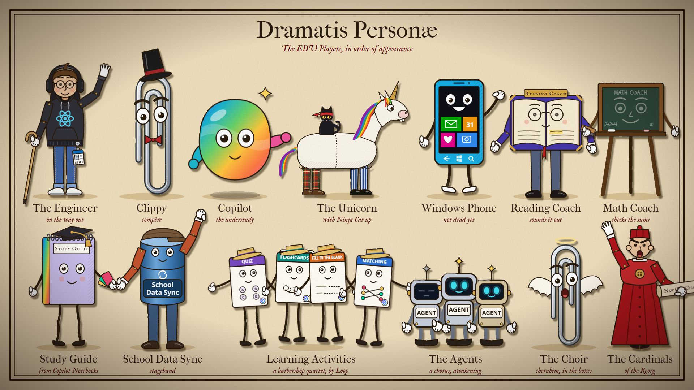

The company: the Engineer, Clippy, Copilot, the Unicorn with Ninja Cat, Windows Phone, Reading Coach, Math Coach, Study
Guide, School Data Sync, the Learning Activities, the Agents, the cherub choir and the Cardinals of the Reorg.

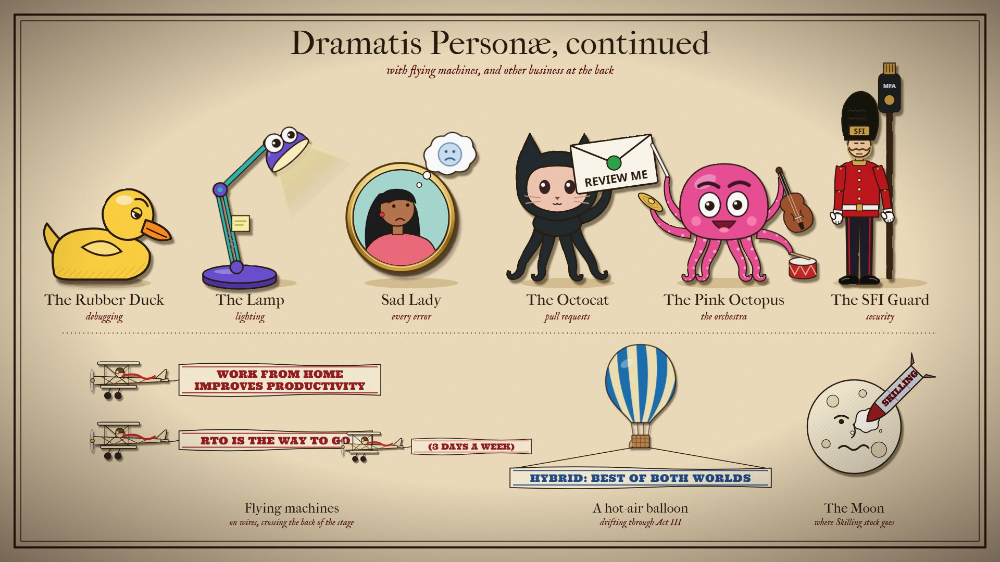

The rest of the company: the Rubber Duck, the Lamp, Sad Lady, the Octocat, the Pink Octopus and the SFI Guard, with the
flying machines, the hybrid balloon and the moon where Skilling stock goes.

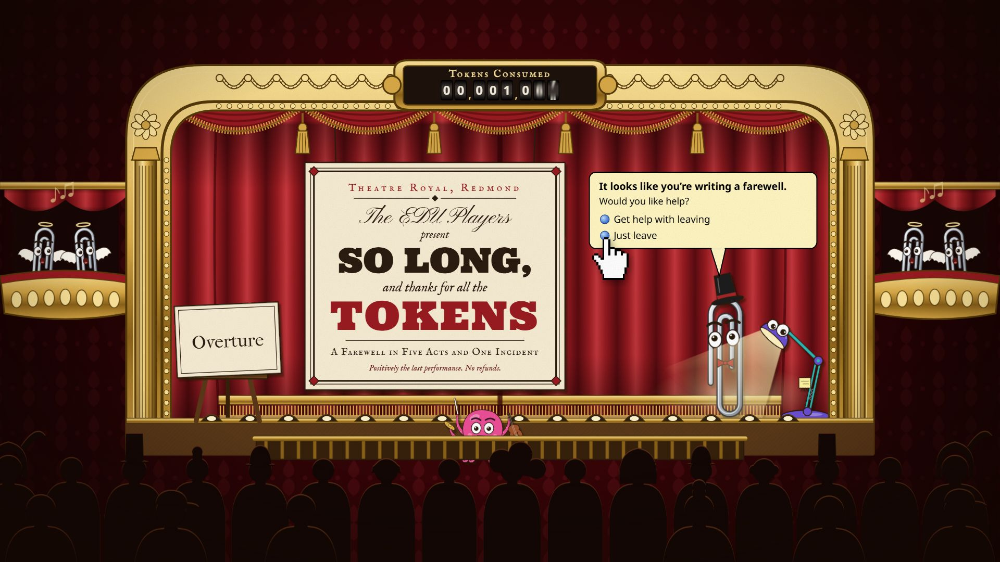

0:10.4, the overture: the playbill flown in, the choir in the boxes, the Lamp's spot on Clippy and the cursor clicking
"Just leave", the Pink Octopus conducting in the pit.

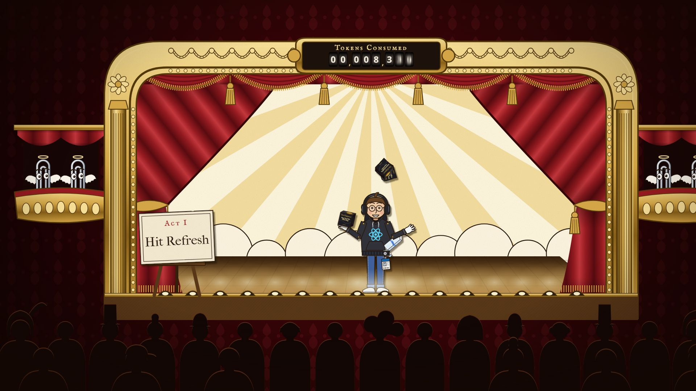

0:36.9, "got the cube": the clouds drawn back, the crystal in the hoodie pocket, the cane hooked on the hood and three
patent cubes in the air.

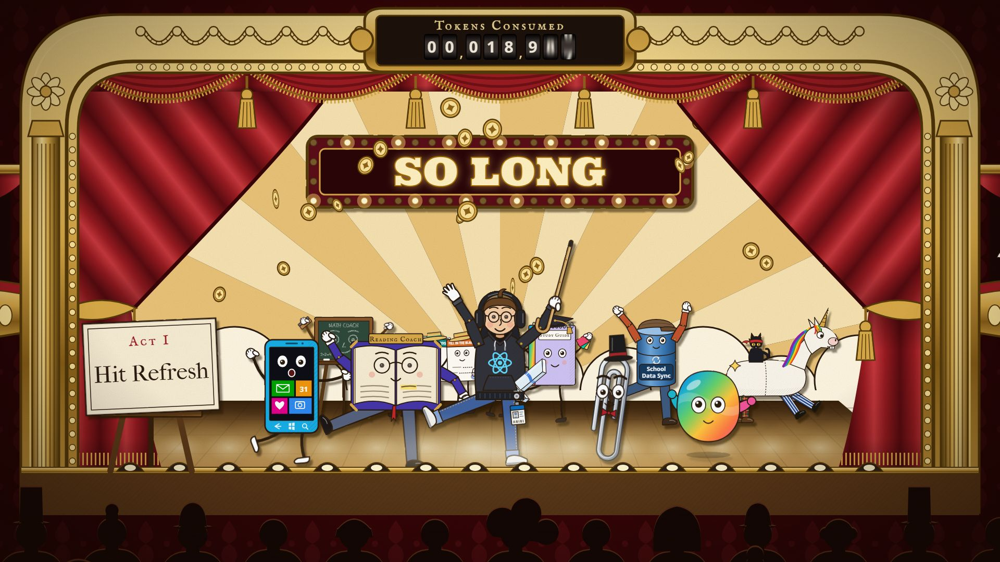

0:51.5, the first chorus: the company in a kick line before the sunburst, tokens raining from the flies.

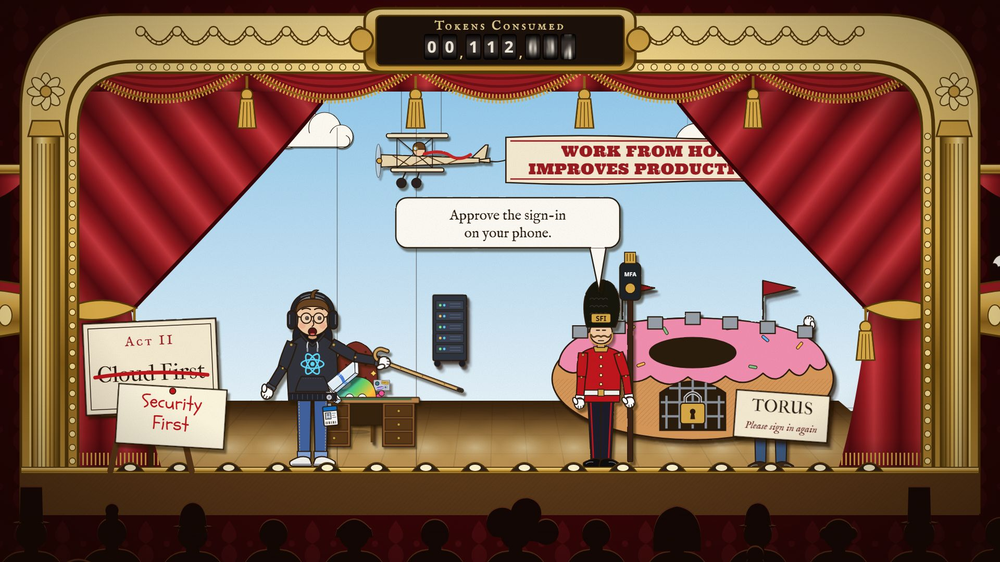

1:25.8, "then moved again": everything off the cloud and into Torus, past the SFI Guard.

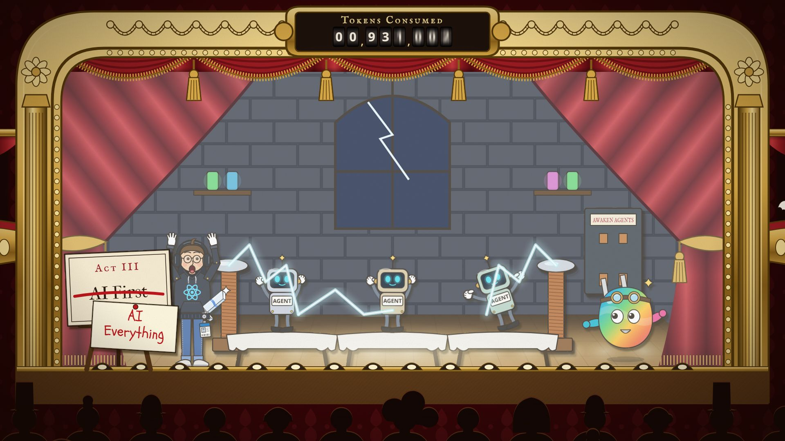

2:07.8, "For every agent we've awoken": lightning, agents sitting up, and the org chart turning over to agents.

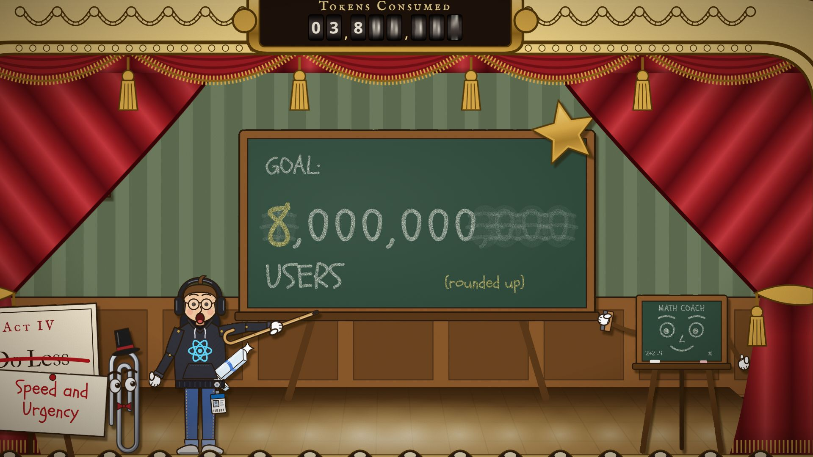

2:36.4, "Small change": Math Coach has rubbed the zeros off the goal and chalked the 1 into an 8.

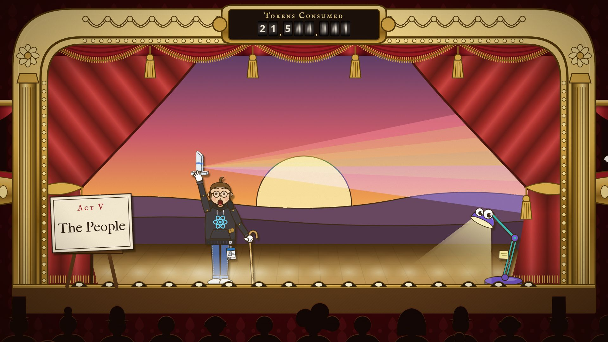

3:10.6, "after ten good years": the crystal held up to the sunset, splitting it into a rainbow.

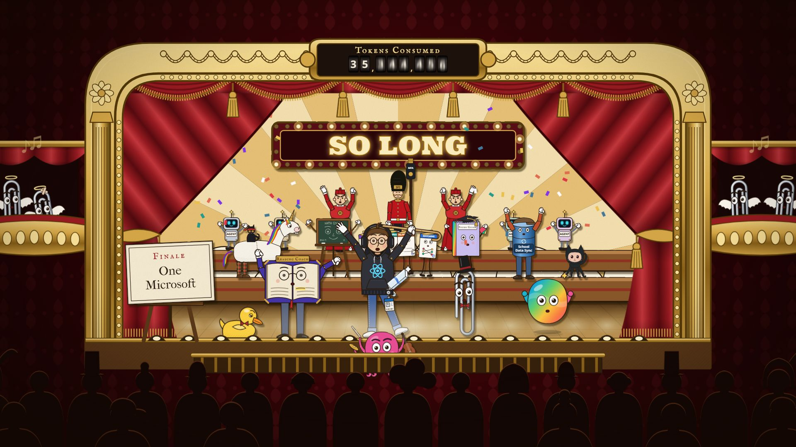

3:20.5, the grand finale: the whole company on the risers, the choir in the boxes and the orchestra in the pit.

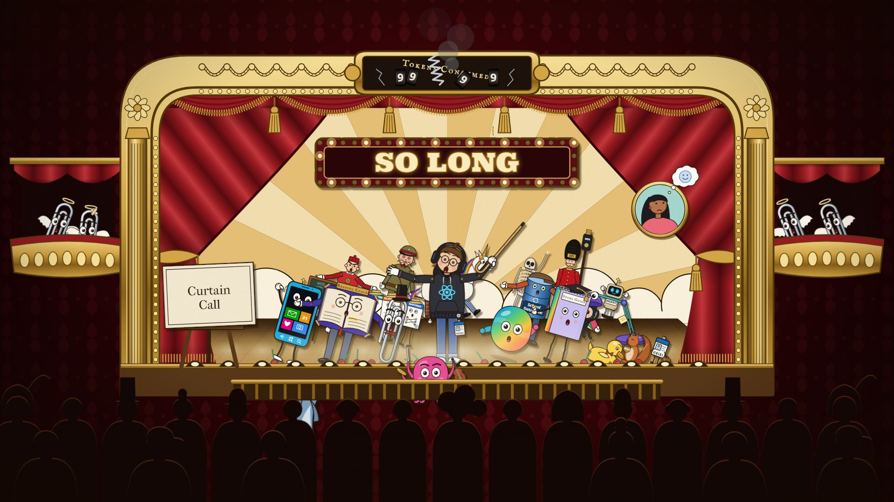

3:58, the curtain call: everyone bowing, roses and tokens on the stage, a dolphin in the stalls and Sad Lady smiling at
last.

## How it moves

- **The camera** mostly holds the stage in a wide shot, as if filmed from the stalls. It pushes in on punchlines, pulls
  back to show the boxes and the pit, and once whips after a flying patent cube.
- **The cut-outs** move on twos, twelve drawings a second, with hinged limbs and snappy eased pops; they hop and kick on
  the beat. The camera, the lights and the scenery move smoothly. For Speed and Urgency the cut-outs go on ones.
- **The cane** is the Engineer's voice: it points, hooks, twirls, taps, conducts, parries and hangs on the hood. The
  script lists its moves.
- **Scene changes** are stagecraft: cloths fly in and land with a bounce, the house curtain drops for the interval and
  the end, trapdoors open, School Data Sync works the lines, the Lamp works the follow spot and the Pink Octopus plays
  in the pit.
- **Business at the back.** Like the flying machines in _Those Magnificent Men in Their Flying Machines_, things cross
  the back of the stage on wires while the main action plays in front: the decade's three flypasts, and the Skilling
  rockets on their way to the moon.
- **Running gags** recur a handful of times each; the script lists them, with Copilot's takeover, the bent cherub and
  Sad Lady's errors.

## Running order

| Part                        | Starts | Lines                                                                     |
| --------------------------- | ------ | ------------------------------------------------------------------------- |
| Overture                    | 0:00   | (flourish and choir)                                                      |
| Act I: Hit Refresh          | 0:13   | "Ten years of Teams calls" to "And now my badge is leaving too!"          |
| Interval                    | 1:16   | (jaunty brass and hand claps)                                             |
| Act II: Cloud First         | 1:23.2 | "We moved to cloud" to "…then watched another incident unfold"            |
| Act III: AI First           | 1:49.3 | "So long…" to "And occasionally compiled too!"                            |
| Act IV: Do Less             | 2:15.7 | "There's always one more meeting due" to "A task left from eight years ago" |
| Interlude: Sincerely        | 2:45.7 | (the music softens)                                                       |
| Act V: The People           | 2:48.5 | "But underneath the builds and on-calls" to "It's time to close a few more Teams" |
| Grand Finale: One Microsoft | 3:19.5 | "So long…" to "The final pull request is through…"                        |
| Epilogue: OOF               | 3:45.9 | "And if anything breaks after Tuesday…" and "I no longer have access."    |
| Curtain call                | 3:53.9 | "SO LOOOOONG!" to "So… long!"                                             |
| Credits                     | 4:13.1 | (silent title cards)                                                      |

## Not drawn

Ideas from planning that didn't make the show; any could go in:

- A Reflect feelings monster checking in during the bridge, "How are you feeling?", and picking bittersweet.
- A blocky Minecraft Education builder stacking the tower of projects on "I built a lot".
- The blue sad face of a crashed PC on the backcloth behind the Kraken.
